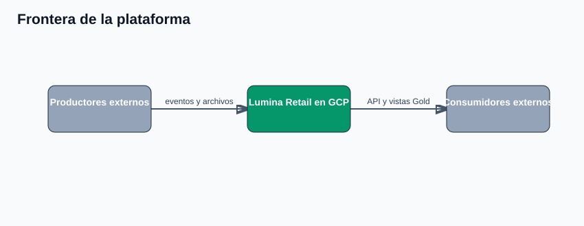
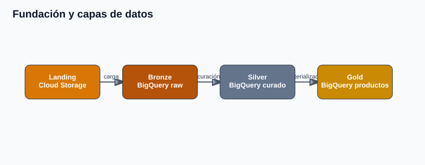
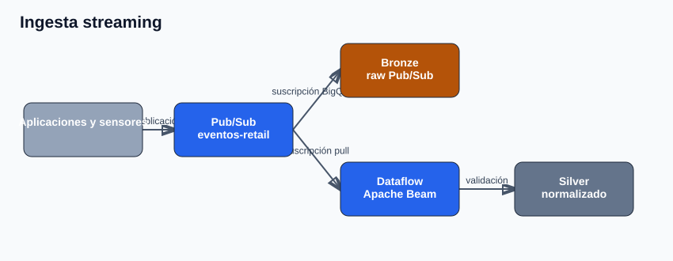
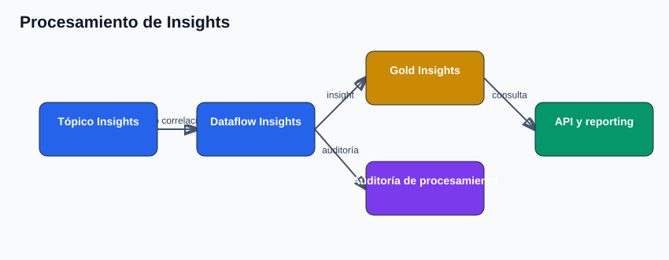
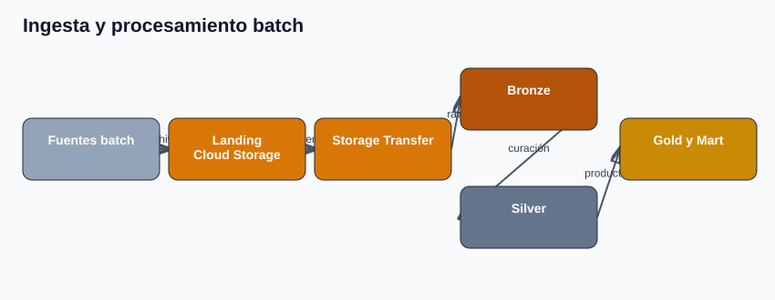
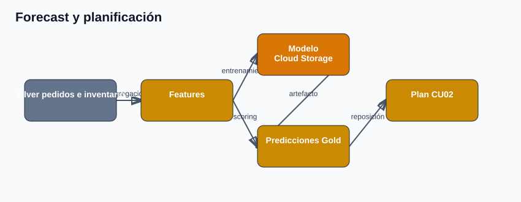
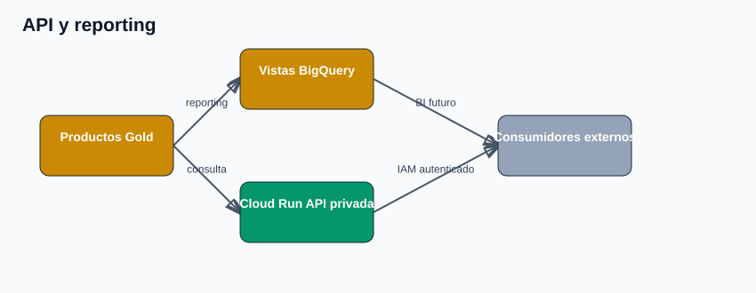
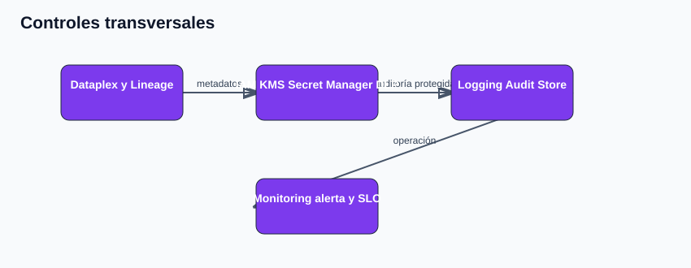
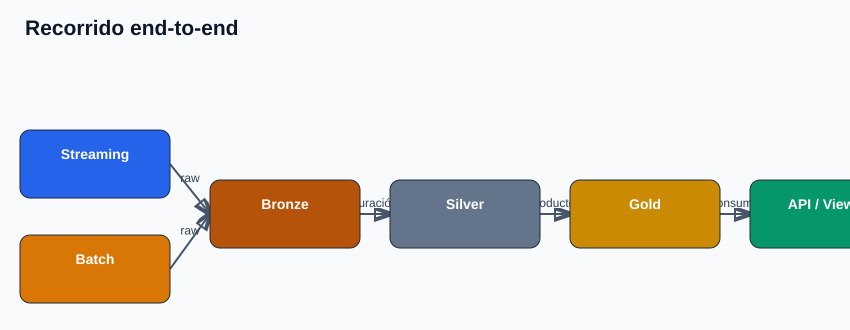

# Informe técnico de implementación GCP

## 1. Resumen técnico

Se implementó una plataforma Lumina Retail en Google Cloud para procesar eventos streaming y cargas batch, conservar datos por capas medallón y entregar productos analíticos a operaciones. La solución usa Cloud Storage, Pub/Sub, Dataflow, BigQuery, Workflows, Dataproc, Cloud Run, Dataplex, Cloud Logging, Cloud Monitoring, KMS, Secret Manager y DLP.

La instalación es reproducible con `config.env` y el runbook `00–83`. Los recursos se nombran a partir de `PROJECT_ID`, `REGION` y `PREFIX`; cada demostración se aísla con `DEMO_RUN_ID`.

## 2. Alcance y frontera de la plataforma

Los productores externos de eventos y archivos se consideran fuentes de datos; no forman parte del despliegue. Los consumidores externos tampoco se provisionan: la plataforma entrega vistas Gold y una API privada para su integración.

Looker no se implementa. Si se requiere distribución event-driven hacia un consumidor externo, se deberá definir un tópico Pub/Sub de salida y su contrato. Los tópicos existentes se usan para ingestión y procesamiento interno.

## 3. Arquitectura implementada

| Capacidad | Servicio GCP | Implementación principal |
|---|---|---|
| Ingesta streaming | Pub/Sub + Dataflow | Tópicos, suscripciones independientes y pipelines Apache Beam. |
| Ingesta batch | Cloud Storage + Storage Transfer | Landing técnico y ruta controlada de transferencia. |
| Medallón | BigQuery | Datasets Bronze, Silver y Gold. |
| Procesamiento batch | Workflows + Dataproc | Orquestación y cómputo efímero. |
| Forecast | BigQuery + Cloud Storage | Features, scoring, planificación y artefacto de modelo. |
| Consumo | Cloud Run + BigQuery Views | API privada y vistas Gold. |
| Controles | IAM, KMS, DLP, Logging, Monitoring y Dataplex | Seguridad, gobierno, auditoría y operación. |

## 4. Fundación y modelo medallón

La fundación habilita APIs, cuentas de servicio, permisos mínimos, buckets y datasets. Cloud Storage conserva Landing, staging técnico, artefactos Dataflow y modelos. Bronze y Silver no son archivos lógicos: se materializan en tablas BigQuery.

| Capa | Servicio | Contenido | Responsabilidad |
|---|---|---|---|
| Landing | Cloud Storage | archivos batch de entrada | recepción técnica y staging |
| Bronze | BigQuery | envelopes raw, payloads y metadatos | trazabilidad y reproceso |
| Silver | BigQuery | pedidos, inventario, entregas, telemetría y dominios batch curados | normalización y calidad |
| Gold | BigQuery | productos de negocio, mart y vistas | consulta operacional y analítica |

Los contratos mantienen claves de correlación como `event_id`, `batch_id`, `scenario_id`, `trace_id`, `order_id`, `sku_id`, `store_id` y `warehouse_id`.

## 5. Flujo streaming

El flujo de eventos usa Pub/Sub como entrada desacoplada. Un productor publica un evento bajo contrato; el tópico entrega copias independientes para retención raw y procesamiento.

1. La suscripción BigQuery conserva el mensaje y sus metadatos en Bronze.
2. La suscripción Dataflow alimenta un pipeline Apache Beam.
3. Dataflow valida estructura, normaliza atributos y escribe entidades Silver.
4. BigQuery materializa productos Gold para los casos de uso.
5. El flujo de Insights escribe `insights_streaming` y auditoría de procesamiento en Gold.

Los jobs de demostración usan un worker, no usan autoscaling y se cancelan al finalizar la validación. La verificación correlaciona el mismo `event_id` entre publicación, Bronze, Silver, Insights y auditoría.

| Configuración | Decisión aplicada |
|---|---|
| Tópico de entrada | `{{PREFIX}}-eventos-retail` |
| Rama raw | suscripción BigQuery hacia Bronze |
| Rama de proceso | suscripción pull para Dataflow |
| Cómputo | un worker, autoscaling desactivado |
| Cierre | estado terminal `CANCELLED` |

## 6. Flujo batch y forecast

Las fuentes batch ingresan como archivos en Landing. La ruta de transferencia controlada mueve los objetos hacia Bronze; los datos raw se cargan a BigQuery, se curan en Silver y se materializan en Gold.

Workflows orquesta el recorrido Bronze → Silver → Gold → Operational Mart. Dataproc se utiliza como cómputo efímero de demostración para procesamiento batch; el clúster se configura con autoeliminación y no constituye una capacidad siempre activa.

El flujo de forecast genera features desde Silver, calcula predicciones y un plan de reposición. Las features, predicciones y planificación se guardan en BigQuery Gold; el artefacto del modelo se guarda en el bucket de modelos. El resultado se incorpora al producto Gold de reposición.

## 7. Productos Gold y consumo

| Producto | Uso operativo |
|---|---|
| `cu01_riesgo_quiebre_despacho` | priorización de riesgo de quiebre y despacho |
| `cu02_plan_reposicion` | reposición por SKU, almacén y fecha |
| `cu03_kpis_operativos` | órdenes, unidades, conversión, costo y SLA |
| `cu04_alertas_mantenimiento` | anomalías y severidad por activo |

El Operational Mart integra fuentes streaming y batch. Cuatro vistas Gold preparan el acceso para reporting. La API privada de Cloud Run consulta tablas Gold y expone rutas de Insights, KPIs, planes de inventario y riesgos de mantenimiento. El acceso se protege con Cloud Run IAM; no se habilita acceso anónimo.

| Recurso | Configuración principal |
|---|---|
| Cloud Run | servicio privado `{{PREFIX}}-insights-api` |
| Autorización | Cloud Run IAM; sin invocación anónima |
| Reporting | cuatro vistas sobre productos Gold |
| Consumidor externo | opcional; no aprovisionado |

## 8. Gobierno, seguridad y operación

| Control | Implementación |
|---|---|
| Catálogo y linaje | Dataplex cataloga activos Bronze, Silver y Gold; Data Lineage registra vínculos Gold → vistas. |
| IAM | cuentas de servicio y permisos por recurso; los scripts detienen divergencias de IAM. |
| Cifrado y secretos | KMS regional, clave con rotación y secreto regional de Secret Manager protegido con CMEK. |
| DLP | plantilla regional para detección sintética de PII sin persistir quotes. |
| Auditoría | sink de Cloud Logging a Audit Store BigQuery. |
| Observabilidad | métrica, alerta y SLO de disponibilidad para la API. |

## 9. Instalación y operación técnica

1. Crear o seleccionar un proyecto con facturación, red, cuotas y políticas organizacionales compatibles.
2. Autenticar `gcloud` y Application Default Credentials.
3. Copiar `config.env.example` a `config.env` y definir proyecto, región, red, prefijo y ejecución.
4. Ejecutar `bash scripts/00_runbook.sh` para validar el inventario.
5. Ejecutar los grupos en el orden de `config/runbook.json`.
6. Usar un `DEMO_RUN_ID` nuevo para cada ensayo y ejecutar los cierres de Dataflow cuando corresponda.

El script 90 se mantiene fuera de la secuencia porque elimina cómputo opcional.

## 10. Evidencia gráfica de aprovisionamiento

La arquitectura adjunta es la evidencia de diseño. Las capturas de consola se deben incorporar sin edición funcional en `../assets/evidencia/`.

| Archivo previsto | Vista GCP | Confirma |
|---|---|---|
| `01-storage.png` | Cloud Storage | Landing, artefactos y modelos |
| `02-bigquery-medallion.png` | BigQuery | datasets y tablas Bronze, Silver, Gold y Audit Store |
| `03-pubsub-dataflow.png` | Pub/Sub y Dataflow | tópicos, suscripciones y jobs temporales |
| `04-batch-orquestacion.png` | Workflows, Storage Transfer y Dataproc | integración batch y cómputo efímero |
| `05-cloud-run-api.png` | Cloud Run | servicio privado y revisión activa |
| `06-controles-plataforma.png` | Dataplex, KMS, Secret Manager y Monitoring | gobierno, seguridad y observabilidad |

## 11. Límites y siguientes pasos

- Integrar productores externos reales y acordar contratos, SLA y frecuencia.
- Definir retención, presupuesto, cuotas y alertamiento de producción.
- Evaluar un tópico de salida para integración event-driven externa.
- Implementar una aplicación de consumo o BI sobre las vistas Gold.
- Ajustar escalamiento y operación continua antes de usar datos productivos.
