# Lumina Retail | Informe de implementación y validación de la plataforma de datos

**Organización:** RetailSmart Global · **Solución:** Lumina Retail · **Documento:** Informe técnico de implementación · **Plataforma:** Google Cloud

## Índice

1. [Resumen ejecutivo](#1-resumen-ejecutivo)
2. [Contexto empresarial y objetivos](#2-contexto-empresarial-y-objetivos)
3. [Arquitectura de solución](#3-arquitectura-de-solucion)
4. [Fuentes, contratos y arquitectura de datos](#4-fuentes-contratos-y-arquitectura-de-datos)
5. [Implementación de pipelines streaming](#5-implementacion-de-pipelines-streaming)
6. [Implementación de pipelines batch](#6-implementacion-de-pipelines-batch)
7. [Transformación, calidad e integración](#7-transformacion-calidad-e-integracion)
8. [Modelado analítico y productos Gold](#8-modelado-analitico-y-productos-gold)
9. [Exposición y consumo de datos](#9-exposicion-y-consumo-de-datos)
10. [Seguridad, gobierno y observabilidad](#10-seguridad-gobierno-y-observabilidad)
11. [Validación end-to-end y resultados](#11-validacion-endtoend-y-resultados)
12. [Conclusiones y hoja de evolución](#12-conclusiones-y-hoja-de-evolucion)

**Anexos:** [A. Inventario GCP](#anexo-a-inventario-de-recursos-gcp) · [B. Contratos Pub/Sub](#anexo-b-contratos-pubsub) · [C. Contratos API](#anexo-c-contratos-api) · [D. Diccionario de datos](#anexo-d-diccionario-de-datos) · [E. Metadatos y linaje](#anexo-e-metadatos-y-linaje) · [F. Contratos batch](#anexo-f-contratos-batch) · [G. Productos Gold](#anexo-g-productos-analiticos-gold) · [H. Seguridad y operación](#anexo-h-seguridad-y-operacion) · [I. Pruebas y evidencias](#anexo-i-pruebas-y-evidencias) · [J. Referencias](#anexo-j-referencias-y-artefactos).

---

## 1. Resumen ejecutivo

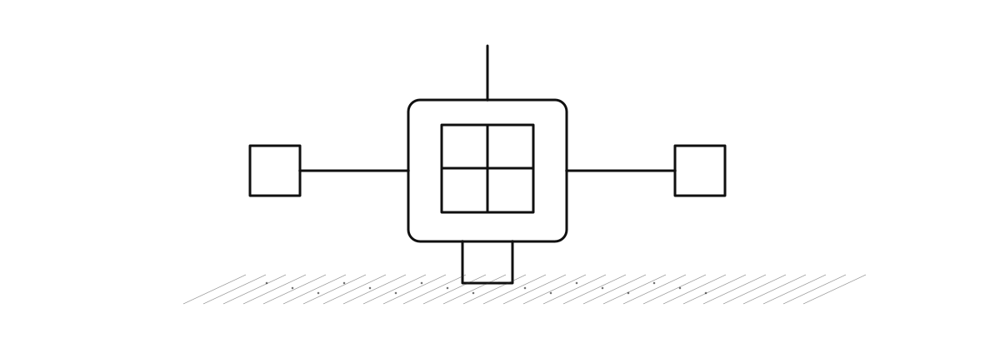

### Visión ejecutiva y alcance

RetailSmart Global necesita transformar señales fragmentadas de pedidos, inventario, logística y telemetría en información trazable para decisiones operativas. Lumina Retail implementa una plataforma analítica desacoplada de los sistemas transaccionales. La solución integra **pipelines de transformación, procesamiento híbrido por lotes y en tiempo real y productos analíticos**, con trazabilidad entre fuentes, procesamiento y consumo.

| Compromiso | Materialización técnica | Criterio de aceptación |
|---|---|---|
| Procesamiento continuo | Pub/Sub → Apache Beam/Dataflow → BigQuery Silver/Gold | Correlación del mismo `event_id` entre entrada, curación y salida |
| Procesamiento por lotes | Landing → BigQuery Bronze/Silver/Gold, orquestado con Workflows | `batch_id` y conteos conciliados en cada etapa |
| Integración de datos | Normalización, reglas de calidad y joins por claves sustentadas | Evidencia SQL y resultado antes/después |
| Analítica | Productos Gold, Operational Mart, vistas | Esquemas, granularidad y consultas reproducibles |

**Límites de la solución:** los sistemas productores empresariales y las aplicaciones consumidoras externas permanecen desacoplados de la plataforma. La predicción de demanda se incorpora como una capacidad analítica de referencia. Los beneficios operativos se evalúan contra una línea base y resultados reproducibles.

**Criterio de aceptación:** trazabilidad verificable entre los eventos o archivos de origen, las transformaciones aplicadas y los productos de datos publicados. Los resultados de ejecución se consignan en el capítulo 11.

---

## 2. Contexto empresarial y objetivos

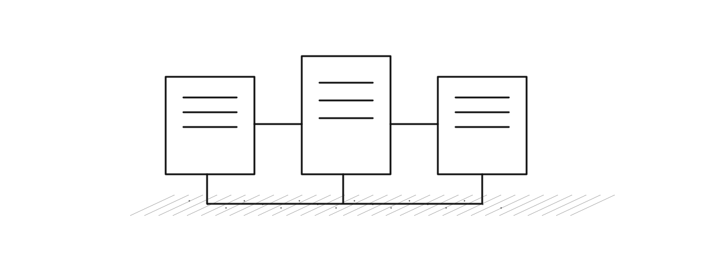

### Situación empresarial

La arquitectura responde a cinco problemas documentados: riesgo de quiebre de stock, desalineación geográfica del inventario, saturación operativa, comportamiento fragmentado del cliente y riesgo de fallas de activos. La plataforma habilita cuatro verticales de análisis y recomendación, sin convertirse en sistema transaccional de registro.

| Necesidad | Señal o producto de datos | Dependencia |
|---|---|---|
| Anticipar quiebre | CU01 riesgo de quiebre | pedidos, inventario, SKU, tienda |
| Planificar reposición | CU02 plan de reposición | histórico, stock, predicción |
| Evaluar operación | CU03 KPIs operativos | pedidos, entregas, periodos |
| Priorizar mantenimiento | CU04 alertas de mantenimiento | telemetría y activos |

### Alcance de la implementación

La implementación se organiza en tres capacidades principales: limpieza, enriquecimiento e integración de fuentes; procesamiento híbrido de eventos y lotes; y consolidación de estructuras analíticas. Gobierno, exposición mediante API y predicción complementan estas capacidades.

**Hipótesis de valor:** integrar datos con trazabilidad permite decisiones más oportunas. **Validación requerida:** medir tiempo de disponibilidad del dato, completitud, duplicados y conciliación por escenario. Los indicadores de servicio se evalúan con mediciones de ejecución y una línea base explícita.

---

## 3. Arquitectura de solución

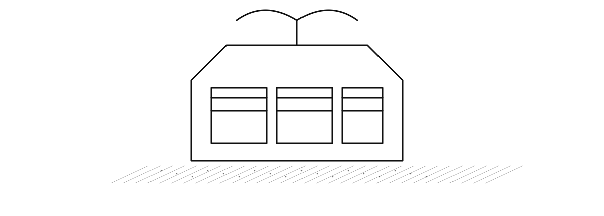

### Arquitectura de referencia y arquitectura implementada

La vista ArchiMate describe los componentes, integraciones y responsabilidades de la solución. El inventario de servicios y sus configuraciones se presenta en el anexo A.

| Componente | Diseño de referencia | Implementación de Lumina Retail | Consideraciones operativas |
|---|---|---|---|
| Bronze y Silver | Almacenamiento de objetos / Parquet | BigQuery | SQL unificado y acceso analítico; controlar costos de almacenamiento y consultas |
| Landing | Cloud Storage | Cloud Storage | Conservación de archivos de entrada y URI de origen |
| Mensajería | Pub/Sub | Pub/Sub | Suscripciones independientes para raw y procesamiento |
| Streaming | Beam/Dataflow | Beam/Dataflow | Separación de transporte, validación y escritura |
| Batch | Procesamiento por lotes | Workflows + SQL / cómputo opcional | Orquestación explícita; Dataproc efímero si corresponde |
| Exposición | Productos analíticos | BigQuery Gold + Cloud Run privado | Lectura IAM y API sin consumidor externo aprovisionado |

**Control operativo:** la ejecución de los servicios se complementa con conciliaciones de registros y comprobación de los datos materializados. El estado de infraestructura y la integridad del dato se supervisan por separado.

**Figura EV-ARC-01 — Inventario de servicios GCP**

*Figura de referencia operativa. Vista prevista: proyecto, región, recursos reales y estado. Archivo de evidencia: `01-fundacion/01-inventario-servicios.png`.*

---

## 4. Fuentes, contratos y arquitectura de datos

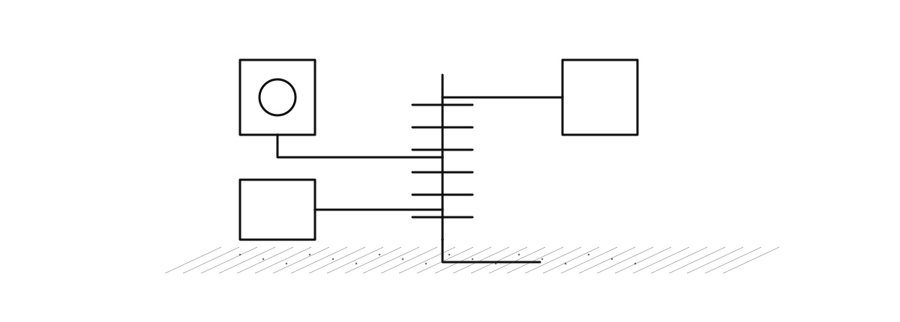

### Fuentes propias y contratos de generación

La implementación utiliza **exclusivamente conjuntos de datos y eventos ad hoc generados para Lumina Retail**. No se han ingerido datasets públicos ni conectado fuentes externas reales. Las familias descritas representan escenarios de negocio simulados y se procesan mediante los contratos y pipelines propios de la plataforma.

| Familia | Fuente de datos | Aplicación en la solución | Precaución |
|---|---|---|---|
| Datos operativos ad hoc | pedidos, inventario y entregas generados para Lumina Retail | cargas batch y modelado analítico | Conservar identificadores, granularidad y versión de generación |
| Datos contextuales ad hoc | benchmark de competidores, eventos locales y redes sociales generados para escenarios controlados | enriquecimiento batch | Identificar cada conjunto como dato sintético, no como extracción externa |
| Eventos operativos ad hoc | pedidos, inventario, sensores y telemetría producidos por generadores propios | procesamiento streaming | Correlacionar evento, escenario y ejecución |

### Contrato lógico de evento

`schema_version`, `simulation_id`, `scenario_id`, `producer_id`, `source_system`, `event_type`, `event_id`, `occurred_at`, `emitted_at`, `trace_id` y `payload` conforman el envelope documentado. La validación física de tipo, obligatoriedad y compatibilidad depende del contrato versionado por productor; ver anexo B.

### Medallion físico

| Capa | Servicio | Responsabilidad |
|---|---|---|
| Landing | Cloud Storage | archivos batch, URI y staging |
| Bronze | BigQuery | raw Pub/Sub, JSON, metadata y lotes |
| Silver | BigQuery | entidades tipadas, normalizadas, con calidad |
| Gold | BigQuery | CU01–CU04, predicciones, Mart y vistas |

**Metadatos mínimos:** identificador de evento/lote, origen, tiempos de negocio e ingesta, versión de esquema, estado de calidad y referencia de ejecución. El diccionario físico debe derivarse de DDL y consultas reales, no de ejemplos narrativos.

**Figura EV-DAT-01 — Buckets de Landing y artefactos**

*Figura de referencia operativa. Vista prevista: ubicación, nombres y políticas de acceso sin exponer secretos. Archivo de evidencia: `01-fundacion/02-storage-buckets.png`.*

**Figura EV-DAT-02 — Datasets Bronze, Silver y Gold**

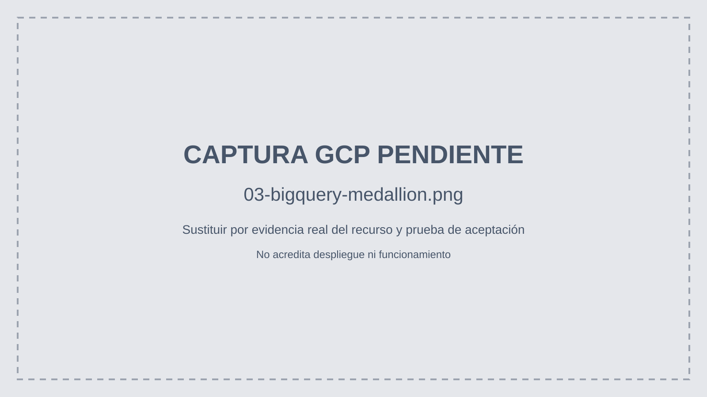

*Figura de referencia operativa. Vista prevista: datasets reales, tablas y región. Archivo de evidencia: `01-fundacion/03-bigquery-medallion.png`.*

---

## 5. Implementación de pipelines streaming

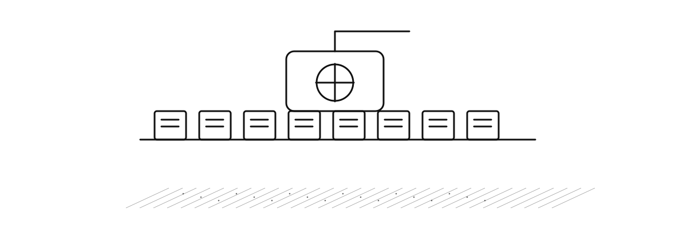

### Bifurcación del tópico de entrada

La publicación se entrega a dos suscripciones independientes: una persiste el raw hacia BigQuery Bronze y otra alimenta el procesamiento Apache Beam/Dataflow hacia Silver. El consumidor debe preservar `event_id`, `message_id`, `publish_time` y los atributos pertinentes. La transformación de `order_created` produce la entidad Silver de pedidos cuando satisface las reglas.

| Etapa | Entrada | Operación | Salida / control |
|---|---|---|---|
| Publicación | JSON de evento | Validación contractual de origen | `event_id` y `messageId` |
| Raw | Suscripción BigQuery | Persistencia del mensaje | `Bronze.eventos_raw_pubsub` |
| Curación | Suscripción Dataflow | Parseo, validación, tipado, filtro | `Silver.pedidos` |
| Negocio | Silver | Reglas y materialización | Productos Gold pertinentes |
| Cierre | Dataflow job | Cancelación explícita | `job_id`, estado terminal |

**Prueba funcional mínima:** publicar un evento único; consultar Bronze y Silver filtrando por el mismo `event_id`; verificar `order_id`, calidad y campos normalizados; conservar el ID del job y su cierre. Los duplicados y eventos tardíos requieren criterios explícitos de idempotencia y vigencia.

### Insights y auditoría

El segundo tópico y su Dataflow producen `Gold.insights_streaming` y `Gold.procesamiento_auditoria`. Se exige la misma correlación en ambas. Si no se observa `EVENTO_RECIBIDO` o `INSIGHT_GENERADO`, registrar el caso como no verificado, aunque el job esté RUNNING.

**Figura EV-STR-01 — Tópico y suscripciones**

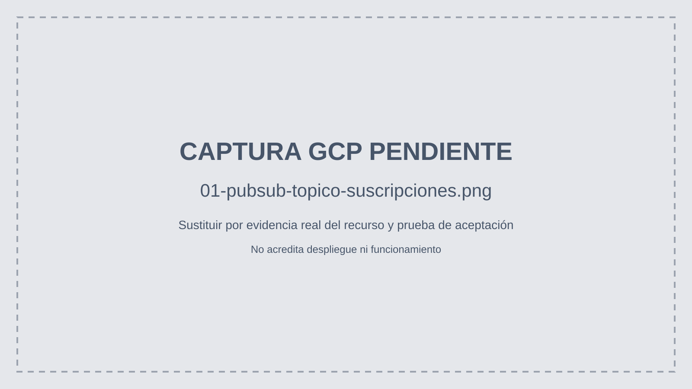

*Figura de referencia operativa. Vista prevista: nombre del tópico y ramas independientes de raw y Dataflow. Archivo de evidencia: `02-streaming/01-pubsub-topico-suscripciones.png`.*

**Figura EV-STR-02 — Ejecución Dataflow**

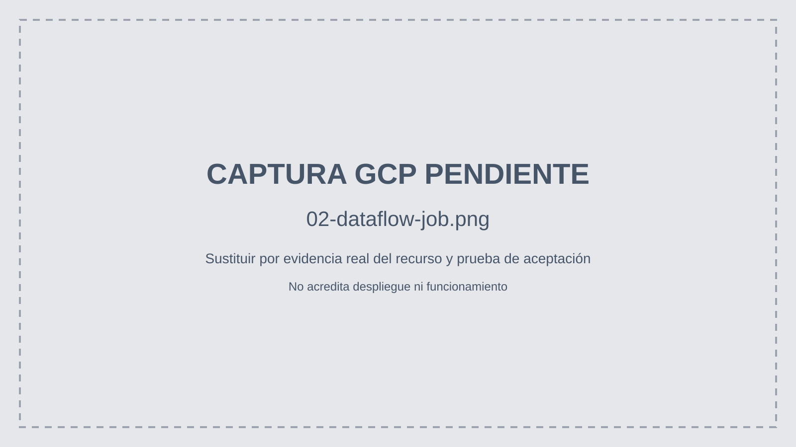

*Figura de referencia operativa. Vista prevista: job, región, worker y estado terminal. Archivo de evidencia: `02-streaming/02-dataflow-job.png`.*

**Figura EV-STR-03 — Evento correlacionado Bronze/Silver**

*Figura de referencia operativa. Vista prevista: mismo event_id y order_id en las consultas. Archivo de evidencia: `02-streaming/03-bq-bronze-silver-evento.png`.*

**Figura EV-STR-04 — Insights y auditoría**

*Figura de referencia operativa. Vista prevista: mismo event_id en ambas tablas Gold. Archivo de evidencia: `03-insights/01-bq-insights-auditoria.png`.*

---

## 6. Implementación de pipelines batch

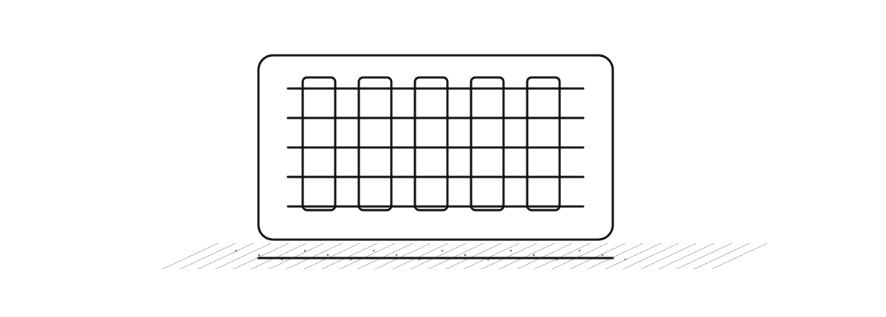

### Recorrido de procesamiento por lotes

Los archivos ingresan a Cloud Storage Landing. Bronze conserva procedencia, `batch_id`, URI, fila y controles de validez; Silver normaliza entidades; Gold publica agregaciones y Operational Mart. Workflows coordina dependencias y estados; no reemplaza por sí mismo el procesamiento SQL o Spark.

| Dominio | Tabla Bronze | Tabla Silver | Clave de negocio declarada |
|---|---|---|---|
| Pedidos | pedidos_raw | pedidos | order_id + order_line_id |
| Inventario | inventario_raw | inventario | snapshot_id |
| Entregas | entregas_raw | entregas | delivery_id |
| Competidores | benchmark_competidores_raw | benchmark_competidores | benchmark_id |
| Eventos locales | eventos_locales_raw | eventos_locales | local_event_id |
| Redes sociales | redes_sociales_raw | redes_sociales | post_id |

### Control de lote

1. Identificar archivo, fecha de extracción, `batch_id`, hash y volumen.
2. Cargar Bronze conservando registro fuente y metadatos.
3. Aplicar normalización, control de claves y rechazos a Silver.
4. Publicar Gold solo con reglas de completitud y granularidad verificadas.
5. Conciliar conteos, nulos y duplicados; registrar estado de Workflow.

**Cómputo bajo demanda:** Storage Transfer gestiona transferencias y Dataproc/Spark puede ejecutar transformaciones intensivas mediante clústeres efímeros, sujetos a políticas de finalización.

**Figura EV-BAT-01 — Landing y transferencia**

*Figura de referencia operativa. Vista prevista: objeto fuente, trabajo y transferencia completada. Archivo de evidencia: `04-batch/01-landing-transfer.png`.*

**Figura EV-BAT-02 — Ejecución Workflows**

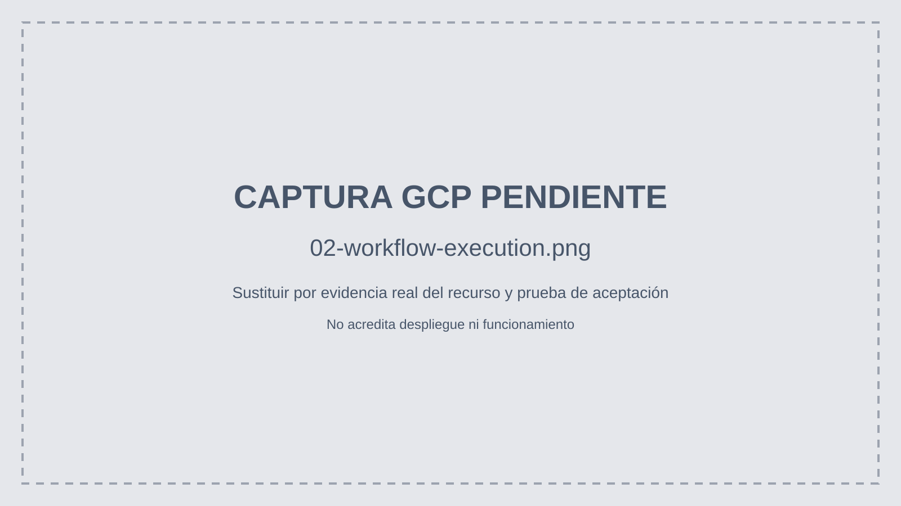

*Figura de referencia operativa. Vista prevista: revisión, cuenta y ejecución SUCCEEDED. Archivo de evidencia: `04-batch/02-workflow-execution.png`.*

**Figura EV-BAT-03 — Recorrido batch a Mart**

*Figura de referencia operativa. Vista prevista: mismo batch_id en Bronze, Silver, Gold y Mart. Archivo de evidencia: `04-batch/03-bq-batch-mart.png`.*

---

## 7. Transformación, calidad e integración

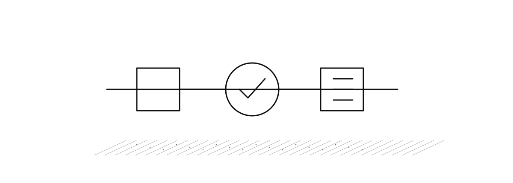

### Reglas de transformación verificables

| Regla | Ejemplo de entrada | Salida esperada | Comprobación |
|---|---|---|---|
| Tipado | cantidad como texto | cantidad numérica o rechazo | tipo físico y error |
| Normalización | identificador con espacios | clave canónica | comparación origen/destino |
| Integridad | pedido sin identificador | registro rechazado o marcado | conteo por calidad |
| Duplicidad | mismo event_id repetido | efecto controlado | consulta por event_id |
| Temporalidad | evento tardío | vigencia registrada | occurred_at vs emitted_at |
| Enriquecimiento | SKU y ubicación válidos | atributos asociados | join sustentado |
| Agregación | múltiples líneas por pedido | métrica a grano declarado | conciliación de importes |

Las reglas de calidad se trazan a su transformación SQL o función de procesamiento, junto con la prueba y el resultado registrado.

### Integración de dominios ad hoc

Los cruces entre pedidos, inventario, entregas y datos contextuales se realizan exclusivamente con claves y correspondencias definidas por los generadores propios. Se preservan la versión del escenario, la trazabilidad del lote o evento y la granularidad de cada entidad. Antes de relacionar ventas con múltiples eventos, los registros se agregan al grano compatible para evitar multiplicar unidades o importes.

### Indicadores de calidad

| Métrica | Fórmula | Interpretación |
|---|---|---|
| Completitud | campos obligatorios presentes / filas recibidas | calidad de origen |
| Duplicidad | claves repetidas / filas recibidas | idempotencia y control |
| Rechazos | filas inválidas / filas recibidas | incumplimiento contractual |
| Conciliación | filas aceptadas + rechazadas vs recibidas | integridad del lote |
| Oportunidad | tiempo de disponibilidad - occurred_at | latencia real |

**Prueba de integración:** registrar para al menos un evento y un lote las entradas, reglas, salidas y consultas antes/después, junto con el identificador de ejecución. Los porcentajes de desempeño se presentan únicamente cuando cuentan con medición reproducible.

---

## 8. Modelado analítico y productos Gold

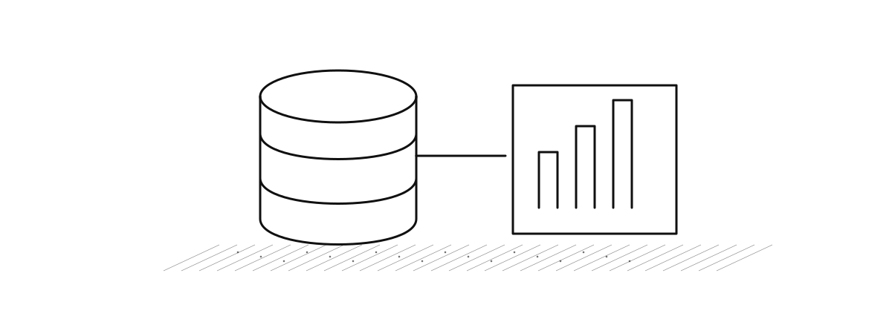

### Modelo analítico y granularidad

| Producto Gold | Grano de consulta propuesto/documentado | Uso |
|---|---|---|
| cu01_riesgo_quiebre_despacho | escenario, SKU y tienda | riesgo y recomendación |
| cu02_plan_reposicion | escenario, SKU, almacén y fecha | planificación |
| cu03_kpis_operativos | escenario, periodo y canal | operación y SLA |
| cu04_alertas_mantenimiento | escenario, activo, sensor y almacén | mantenimiento |
| operational_mart | entity_type, entity_id, ingestion_mode, source_domain | integración transversal |

**Modelo dimensional:** identificar hechos, dimensiones, claves y relaciones físicas solo cuando el DDL y las consultas lo demuestren. El nombre Gold no implica automáticamente un esquema estrella. Se documentará el grano real de cada tabla, particiones, clustering, campos de medida y política de actualización.

### Forecast como capacidad complementaria

`moving_average_7d_baseline` demuestra la cadena `forecast_features` → `forecast_predictions` → `cu02_plan_reposicion`; el artefacto se conserva en el bucket Models bajo `forecast/DEMO_RUN_ID/MODEL_VERSION/model.json`. No se presenta como modelo predictivo final ni se infiere calidad sin evaluación.

### Vistas de reporting

Las vistas deben explicitar columnas, filtros, fuentes Gold y vigencia. El consumidor externo BI permanece fuera del alcance de aprovisionamiento.

**Figura EV-GOL-01 — Forecast, predicción y reposición**

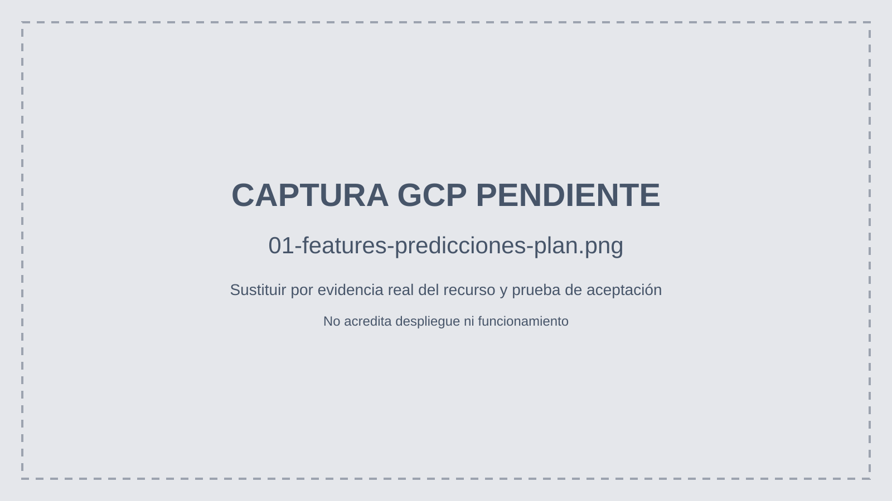

*Figura de referencia operativa. Vista prevista: identificador de corrida en features, predicción, plan y artefacto. Archivo de evidencia: `05-forecast/01-features-predicciones-plan.png`.*

**Figura EV-GOL-02 — Vistas analíticas Gold**

*Figura de referencia operativa. Vista prevista: vistas y consultas con resultados. Archivo de evidencia: `06-consumo/03-bigquery-vistas.png`.*

---

## 9. Exposición y consumo de datos

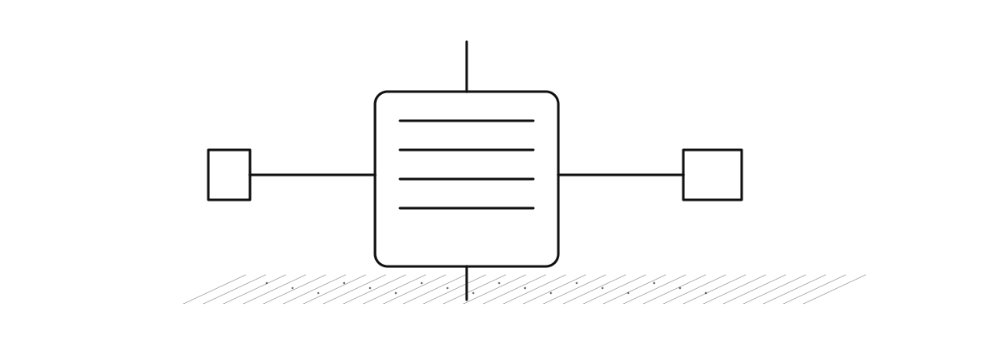

### Contratos de consumo

Cloud Run expone una API privada con autenticación IAM, mínimo cero instancias, máximo dos y límite documentado de 100 filas por solicitud. La integración con consumidores externos se gestiona mediante contratos independientes. Una respuesta de `/healthz` no demuestra la funcionalidad de las rutas de negocio.

| Endpoint | Fuente | Función | Aceptación |
|---|---|---|---|
| `/api/v1/insights` | insights_streaming / CU01 | señales y riesgo | HTTP 200 autenticado y esquema válido |
| `/api/v1/kpis` | CU03 | indicadores | datos Gold consultables |
| `/api/v1/inventory-plans` | CU02 | reposición | respuesta y filtros válidos |
| `/api/v1/maintenance-risks` | CU04 | mantenimiento | respuesta y filtros válidos |

El anexo C documenta cada contrato de forma resumida y exige verificar métodos, parámetros, tipos, estados y estructura exacta en el código fuente antes de declararlos definitivos.

**Figura EV-API-01 — Servicio Cloud Run privado**

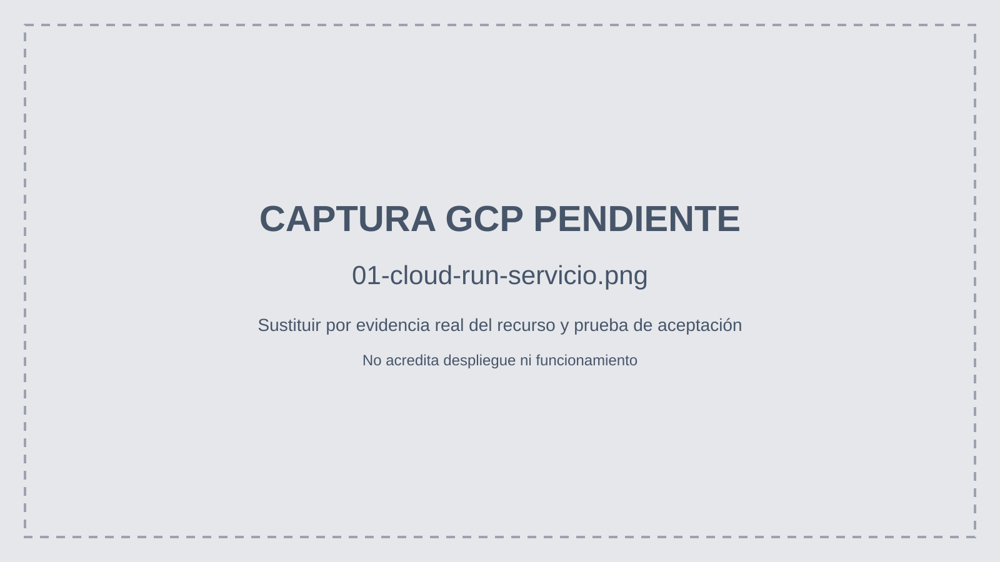

*Figura de referencia operativa. Vista prevista: revisión READY, región, identidad y autenticación. Archivo de evidencia: `06-consumo/01-cloud-run-servicio.png`.*

**Figura EV-API-02 — Respuestas de negocio**

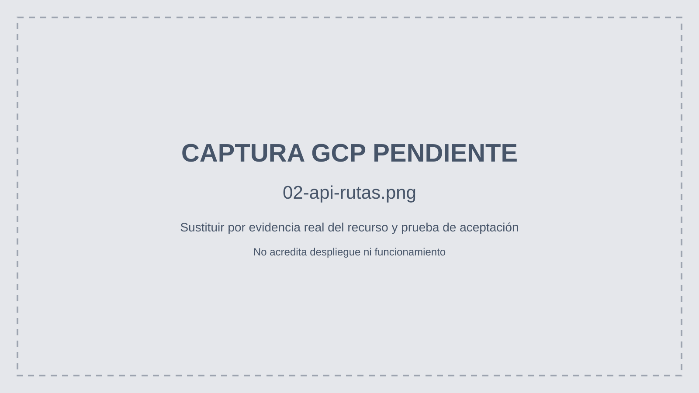

*Figura de referencia operativa. Vista prevista: HTTP 200 autenticado de las cuatro rutas. Archivo de evidencia: `06-consumo/02-api-rutas.png`.*

---

## 10. Seguridad, gobierno y observabilidad

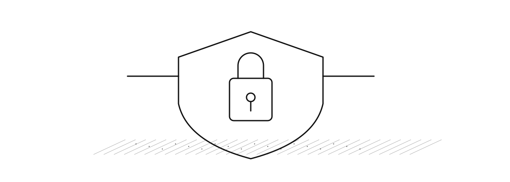

### Controles transversales

| Dominio | Componentes previstos/documentados | Evidencia que acredita |
|---|---|---|
| Gobierno | Dataplex y Data Lineage | activos y relaciones entre fuentes y vistas |
| Identidades | IAM por servicio | permisos mínimos worker, workflow y API |
| Cifrado | KMS y Secret Manager | claves, secreto protegido y referencias sin revelar valores |
| Protección | plantilla DLP regional | configuración de detectores EMAIL, PHONE, CARD |
| Auditoría | Logging sink y BigQuery Audit Store | registro de prueba consultable |
| Observabilidad | Monitoring, alertas y SLO | métrica, política, objetivo y estado |

**Verificación:** el control de auditoría relaciona eventos de origen, exportación al almacén de auditoría y consulta de registros. La disponibilidad del 99 % se establece como objetivo de servicio.

**Figura EV-SEC-01 — Gobierno y cifrado**

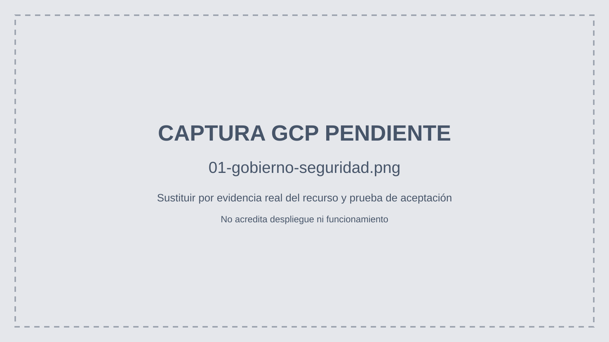

*Figura de referencia operativa. Vista prevista: Dataplex/Lineage, KMS y Secret Manager sin secretos. Archivo de evidencia: `07-controles/01-gobierno-seguridad.png`.*

**Figura EV-SEC-02 — Auditoría y monitoreo**

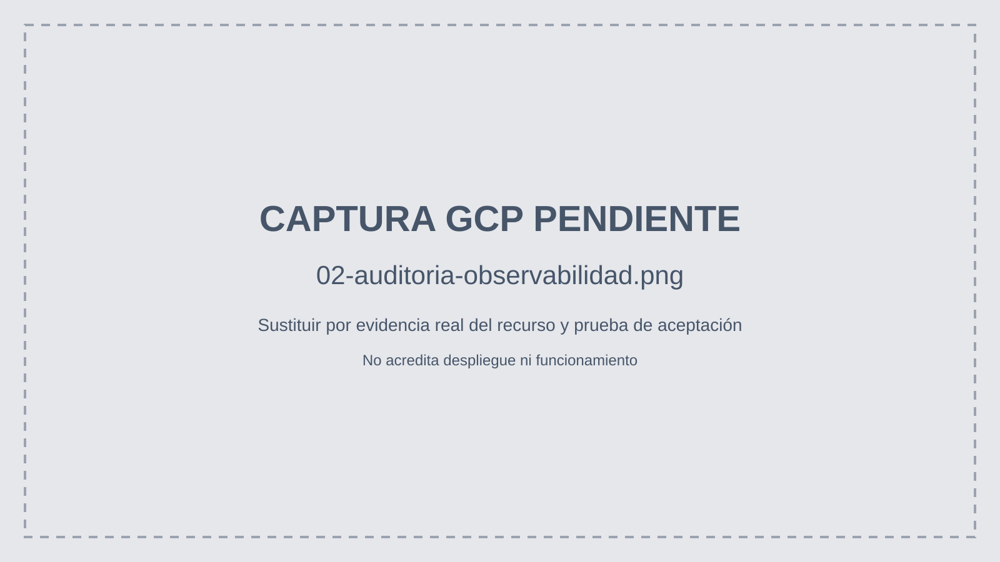

*Figura de referencia operativa. Vista prevista: sink, Audit Store, métrica, alerta y SLO. Archivo de evidencia: `07-controles/02-auditoria-observabilidad.png`.*

---

## 11. Validación end-to-end y resultados

### Matriz de aceptación de la solución

| Prueba | Entrada | Validación | Evidencia | Estado documental |
|---|---|---|---|---|
| VAL-STR-01 | order_created | mismo event_id Bronze/Silver | EV-STR-03 | Evidencia de ejecución no incorporada |
| VAL-STR-02 | evento Insight | mismo event_id en dos Gold | EV-STR-04 | Evidencia de ejecución no incorporada |
| VAL-BAT-01 | archivo batch | Bronze → Silver → Gold/Mart | EV-BAT-03 | Evidencia de ejecución no incorporada |
| VAL-TRF-01 | datos con defectos | tipado, rechazo y deduplicación | SQL y resultado antes/después | Resultado de prueba no incorporado |
| VAL-INT-01 | dominios ad hoc | joins por clave sustentada | SQL y resultado integrado | Resultado de prueba no incorporado |
| VAL-MOD-01 | producto Gold | grano, medidas y consulta | EV-GOL-02 | Evidencia de ejecución no incorporada |
| VAL-API-01 | llamada autenticada | HTTP 200 y respuesta válida | EV-API-02 | Evidencia de ejecución no incorporada |

**Estados de seguimiento:** diseñado, codificado, desplegado, ejecutado, verificado, bloqueado y no verificado. Cada acta conserva `DEMO_RUN_ID`, `event_id`, `batch_id`, `job_id`, fecha y región en cada acta.

### Procedimiento reproducible

1. Preparar `config.env` desde `config.env.example`, sin versionar secretos.
2. Ejecutar `bash automatizacion/scripts/00_runbook.sh` para validar inventario local; **no crea recursos**.
3. Ejecutar grupos conforme a `automatizacion/configuracion/runbook.json`.
4. Registrar IDs de recursos, ejecuciones, consultas, conteos y errores.
5. Cancelar los jobs Dataflow de demostración y verificar estado terminal.
6. No ejecutar el script 90 de eliminación como parte del recorrido estándar.

Las figuras SVG grises señalan el archivo PNG real esperado y son **placeholders**, no pruebas. Antes de entrega formal al cliente, sustituirlas y actualizar la matriz con el resultado observado.

---

## 12. Conclusiones y hoja de evolución

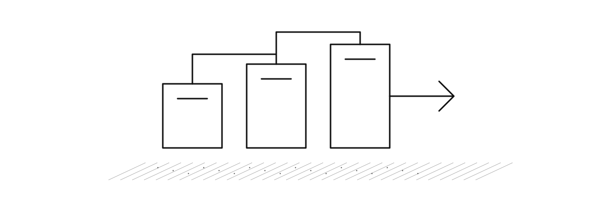

### Resultado documental y límites

La plataforma Lumina Retail integra procesamiento híbrido sobre BigQuery Medallion, con componentes de ingesta, curación, productos Gold, API y controles transversales. La demostración de éxito debe apoyarse en consultas y pruebas de datos, no en el inventario de servicios.

**Decisiones pendientes de operación productiva:** cuotas, costos, retención, escalamiento, SLAs, gobernanza de contratos, monitoreo de calidad, consumidores externos y dimensionamiento. No se extrapolan resultados de una demo con un worker a campañas masivas.

### Hoja de evolución

Priorizar (1) cerrar trazabilidad streaming y batch con evidencias; (2) consolidar diccionarios físicos y contratos versionados; (3) automatizar pruebas de calidad y conciliación; (4) medir latencia/costo bajo escenarios controlados; (5) incorporar consumidores externos con contratos independientes. Las decisiones de arquitectura y sus modificaciones se mantendrán en el registro de decisiones técnicas.

---

## Anexo A. Inventario de recursos GCP

El inventario organiza los servicios de la plataforma por responsabilidad, contrato técnico y mecanismo de observabilidad. La configuración física y el estado operativo se consultan en los registros de despliegue.

| Servicio | Recurso/función documentada | Contrato o metadatos | Evidencia |
|---|---|---|---|
| Cloud Storage | Landing, raw técnico, staging, artifacts, models | bucket, región, URI, lifecycle | EV-DAT-01 |
| BigQuery | datasets Bronze, Silver, Gold; Audit Store | DDL, particiones, labels, tablas | EV-DAT-02 |
| Pub/Sub | eventos-retail, insights-retail y suscripciones | esquema, atributos, ack, delivery | EV-STR-01 |
| Dataflow | pipeline Silver y pipeline Insights | job, worker, región, logs | EV-STR-02 |
| Workflows | orquestación batch | definición, revisión, ejecución | EV-BAT-02 |
| Storage Transfer | transferencia de lotes | job, fuente, destino, estado | EV-BAT-01 |
| Dataproc | cómputo Spark efímero, cuando se ejecute | job, cluster, autoeliminación | acta de ejecución |
| Cloud Run | API privada | revisión, IAM, endpoints | EV-API-01 |
| Dataplex / Lineage | catálogo y linaje | activos, vínculos | EV-SEC-01 |
| IAM | service accounts y roles | miembros y bindings | EV-SEC-01 |
| KMS / Secret Manager | cifrado y secreto | clave, versión, política | EV-SEC-01 |
| Sensitive Data Protection (DLP) | plantilla de inspección | tipos y región | EV-SEC-01 |
| Logging / Monitoring | sink, métrica, alerta, SLO | filtros, destino, objetivo | EV-SEC-02 |

## Anexo B. Contratos Pub/Sub

| Tópico / mensaje | Productor / consumidor | Identificadores | Validación requerida |
|---|---|---|---|
| eventos-retail | productor de eventos → Bronze y Dataflow | event_id, schema_version, trace_id | envelope, tipo, tiempos, payload, compatibilidad |
| insights-retail | emisor de Insights → Dataflow Gold | event_id, scenario_id | formato, deduplicación, destinos Gold |

**Envelope común documentado:** `schema_version`, `simulation_id`, `scenario_id`, `producer_id`, `source_system`, `event_type`, `event_id`, `occurred_at`, `emitted_at`, `trace_id`, `payload`. El payload es **polimórfico**: cada `event_type` necesita su contrato propio. La obligatoriedad se define en el esquema versionado.

**Ficha por contrato:** nombre y versión, productor, consumidores, tópico/suscripción, esquema físico, campos obligatorios, ejemplos sintéticos, reglas de calidad, tratamiento de error, reintento, idempotencia y retención configurada. La suscripción BigQuery raw y la suscripción pull de Dataflow se documentan separadamente.

## Anexo C. Contratos API

| Ruta | Método | Autenticación | Fuente | Respuesta y errores |
|---|---|---|---|---|
| `/api/v1/insights` | verificar en código | IAM privada | insights_streaming/CU01 | JSON y errores: verificar implementación |
| `/api/v1/kpis` | verificar en código | IAM privada | CU03 | JSON y errores: verificar implementación |
| `/api/v1/inventory-plans` | verificar en código | IAM privada | CU02 | JSON y errores: verificar implementación |
| `/api/v1/maintenance-risks` | verificar en código | IAM privada | CU04 | JSON y errores: verificar implementación |

**Campos del contrato de servicio:** verbo HTTP, parámetros de consulta y sus tipos, valores por defecto, filtros, límite máximo de 100 filas documentado, paginación si existe, forma exacta del JSON, códigos de error y roles de invocación. **Se documentan únicamente** respuestas de ejemplo ni códigos no verificados.

## Anexo D. Diccionario de datos

**Estructura del diccionario por cada tabla física:** dataset, nombre, descripción, grano, origen, clave natural/técnica, partición, clustering, retención, propietario, fecha de actualización y DDL versionado. Cada columna deberá incluir **nombre, tipo BigQuery, modo NULLABLE/REQUIRED/REPEATED, descripción, transformación, fuente, sensibilidad y regla de calidad**. El siguiente índice agrupa los dominios de datos; los esquemas físicos se gestionan mediante los DDL y el catálogo de BigQuery.

| Dataset lógico | Tablas / familias identificadas | Grano y clave a contrastar |
|---|---|---|
| Bronze | eventos_raw_pubsub, pedidos_raw, inventario_raw, entregas_raw, benchmark_competidores_raw, eventos_locales_raw, redes_sociales_raw | mensaje/archivo/fila; claves raw |
| Silver | pedidos, inventario, entregas, benchmark_competidores, eventos_locales, redes_sociales | order_id + order_line_id; snapshot_id; delivery_id; otras claves del capítulo 6 |
| Gold | insights_streaming, procesamiento_auditoria, cu01_riesgo_quiebre_despacho, cu02_plan_reposicion, cu03_kpis_operativos, cu04_alertas_mantenimiento | evento o grano de negocio declarado |
| Gold | operational_mart, forecast_features, forecast_predictions, vistas de reporting | entidad, escenario, periodo y versión |

**Fuente de verdad del diccionario:** DDL versionado y catálogo de columnas de BigQuery (`INFORMATION_SCHEMA.COLUMNS`). Los tipos, modos y particiones se documentan exclusivamente a partir de estos esquemas.

## Anexo E. Metadatos y linaje

| Metadato | Nivel | Propósito |
|---|---|---|
| event_id, trace_id, message_id | evento | correlación Pub/Sub → Bronze → Silver → Gold |
| occurred_at, emitted_at, publish_time | evento | oportunidad y orden temporal |
| batch_id, source_uri, source_row_number, hash | lote/fila | reproceso y conciliación |
| scenario_id, simulation_id, DEMO_RUN_ID | prueba | aislar recorridos |
| job_id, execution_id, training_run_id | cómputo | auditoría de ejecución |
| schema_version, model_version | contrato/modelo | compatibilidad y reproducibilidad |
| quality_status | registro | aceptación o rechazo |

Registrar linaje **fuente → tópico/archivo → Bronze → transformación → Silver → Gold → vista/API**. Donde Dataplex/Lineage no ofrezca vínculo físico, mantener linaje documentado como tal y no simular una captura automática.

## Anexo F. Contratos batch

| Dominio | Contrato mínimo | Clave de conciliación |
|---|---|---|
| pedidos | formato, columnas, fecha de extracción, cantidades y moneda | order_id + order_line_id |
| inventario | SKU, ubicación, snapshot y cantidades | snapshot_id |
| entregas | entrega, estado, fechas y ubicación | delivery_id |
| benchmark_competidores | fuente, producto, precio, fecha y moneda | benchmark_id |
| eventos_locales | evento, ubicación, fecha y categoría | local_event_id |
| redes_sociales | publicación, fuente, fecha y señal | post_id |

La obligatoriedad, los tipos y los formatos se tomarán del parser/DDL real; las columnas descritas son **familias semánticas**, no un esquema físico confirmado. Adjuntar URI de ejemplo sintético, política de errores y frecuencia por fuente cuando estén definidas.

## Anexo G. Productos analíticos Gold

| Producto | Consumidor | Validación |
|---|---|---|
| CU01 riesgo de quiebre | Insights/API | correlación escenario, SKU y tienda |
| CU02 reposición | API/planificación | escenario, SKU, almacén, fecha y versión |
| CU03 KPIs | API/reporting | periodo, canal y métricas reconciliadas |
| CU04 mantenimiento | API/operación | activo, sensor, severidad y tiempo |
| Operational Mart | consultas transversales | fuente, modo de ingesta y entidad |
| Forecast features/predictions | CU02 | versión, horizonte, training_run_id |

Cada producto requiere DDL, grano, claves, medidas, consulta SQL, periodicidad, reglas de actualización y evidencia de al menos una fila de prueba. Evitar afirmar un esquema estrella si el modelo físico no lo implementa.

## Anexo H. Seguridad y operación

Documentar identidades worker/workflow/API, permisos IAM efectivos, región de KMS, referencias Secret Manager, configuración DLP, Logging sink, Audit Store, métricas y SLO. Distinguir **configuración declarada**, **despliegue** y **prueba de funcionamiento**. No incluir secretos ni tokens. El SLO de disponibilidad 99 % es objetivo, no cumplimiento medido.

## Anexo I. Pruebas y evidencias

El catálogo de evidencias en `../assets/evidencia/` contiene las referencias visuales de cada control. Las figuras de reserva no sustituyen las capturas de ejecución ni los registros de prueba. Cada caso debe registrar: identificador, objetivo, precondiciones, entrada, comandos/SQL, resultado esperado, resultado observado, captura, fecha, entorno y conclusión. Las pruebas se organizan por ingesta continua, procesamiento batch, transformación, integración y modelado analítico.

## Anexo J. Referencias y artefactos

- [Informe de arquitectura de referencia](https://github.com/Codenid/lumina-retail-data-platform/blob/main/docs/report/Lumina_Retail_Informe.pdf).
- `automatizacion/configuracion/runbook.json` y `automatizacion/scripts/00_runbook.sh`.
- `docs/operacion/runbooks/` para verificadores y operación.
- `soluciones/` para pipelines, API y productos desplegables.
- `../assets/arquitectura/` para ArchiMate; `../assets/miniportadas/` para ilustraciones; `../assets/evidencia/` para capturas.

**Gestión de configuración:** el inventario de recursos, contratos, DDL y despliegues se mantiene trazable con la configuración de la plataforma y sus registros operativos.
